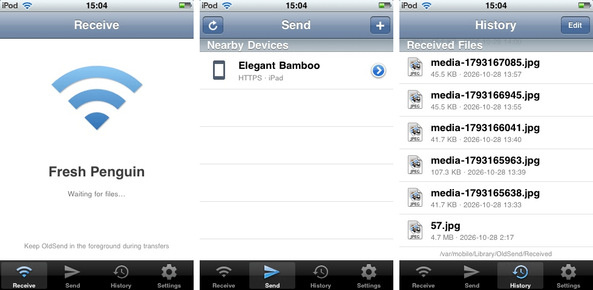

#
<p align="center">

<h1 align="center">OldSend</h1>
<h3 align="center">A native LocalSend-compatible client for iOS 3.1.3 and later</h3>
</p>

[简体中文](README_zh.md)

## Preview



## Features

- Native Objective-C / UIKit application supporting iPhone/iPod touch/iPad, with no dependency on Flutter, Electron, or web runtimes.
- Compatible with LocalSend protocol v2.2: multicast discovery, register, prepare-upload, upload, and cancel.
- Implements the TLS 1.2 protocol using bundled mbedTLS 2.28.8.
- Supports sending photos, videos, text, and device files (with a built-in jailbroken filesystem browser).
- Simplified Chinese and English interfaces.

> A jailbroken device is required. OldSend is installed as a system app under `/Applications`.

## Installation

Download the `.deb` or `.ipa` from [releases](https://github.com/lihaoyun6/OldSend/releases/latest) page.

- `.deb`: install with Cydia, iFile or `dpkg -i OldSend_v1.0.1_iphoneos-arm.deb`.
- `.ipa`: install with AppSync / `installipa` on a jailbroken device. It is not an App Store-signed IPA.

## Build

Requirements: macOS, Xcode command line tools, the iPhoneOS 3.1.3 SDK, the iPhoneOS 4.2 SDK, and `ldid`.

```bash
export SDK=/path/to/iPhoneOS3.1.3.sdk
export SDK_DYLIB=/path/to/iPhoneOS4.2.sdk

./build.sh            # universal armv6 + armv7 -> build/OldSend.app
./build.sh armv6      # armv6 only -> build/OldSend.app
./build.sh armv7      # armv7 only -> build-armv7/OldSend.app
./build.sh clean      # remove build/ and build-armv7/
```

The main app is built with the 3.1.3 SDK. The photo/video picker lives in `MediaPicker.dylib`, built separately with the 4.2 SDK for armv6 + armv7 with a minimum of iOS 4.0. On iOS 3 the dylib fails to load and the app falls back to the system picker.

`JOBS=N ./build.sh` controls parallel compilation. The SDKs default to `$TMPDIR/sdk/iPhoneOS3.1.3.sdk` and `$TMPDIR/sdk/iPhoneOS4.2.sdk`; override them with `SDK=` and `SDK_DYLIB=`.

To deploy manually:

```bash
scp -r build/OldSend.app root@<device-address>:/Applications/
ssh root@<device-address> 'killall -9 SpringBoard'
```

Launch OldSend from the home screen after SpringBoard restarts.

## Third-party

- [mbedTLS](https://github.com/Mbed-TLS/mbedtls) — Apache-2.0
- [cJSON](https://github.com/DaveGamble/cJSON) — MIT
- The History tab icon is derived from [Material Icons](https://github.com/google/material-design-icons) — Apache-2.0

> OldSend is an independent project and is not affiliated with the LocalSend project.
