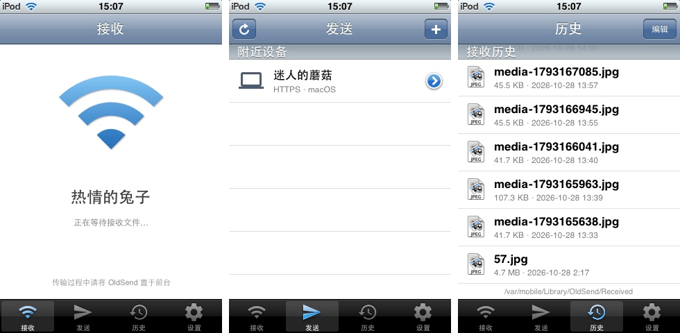

#
<p align="center">

<h1 align="center">OldSend</h1>
<h3 align="center">最低可以运行在 iOS 3.1.3 上的原生 LocalSend 兼容客户端</h3>
</p>

[English](README.md)

## 预览



## 功能

- 原生 Objective-C / UIKit 应用，不依赖 Flutter、Electron 或网页运行时。
- 支持在装有 iOS 3.1.3 或更高版本的 iPhone/iPod touch/iPad 上运行。
- 兼容 LocalSend 协议 v2.2：组播发现、register、prepare-upload、upload 和 cancel。
- 内置 mbedTLS 2.28.8 实现 TLS 1.2 协议。
- 支持发送照片、视频、文本、剪贴板内容和设备文件（内置越狱文件系统浏览器）。
- 简体中文和英文界面。

> 需要越狱：应用以系统应用形式安装到 `/Applications`。

## 安装

从 [releases](https://github.com/lihaoyun6/OldSend/releases/latest) 页面下载 `.deb` 或 `.ipa` 安装包。

- `.deb`：使用 Cydia、iFile 或 `dpkg -i OldSend_v1.0.1_iphoneos-arm.deb` 安装。
- `.ipa`：在越狱设备上使用 AppSync / `installipa` 安装。此 IPA 不是 App Store 签名包。

## 手动编译

依赖：macOS、Xcode 命令行工具、iPhoneOS 3.1.3 SDK、iPhoneOS 4.2 SDK 和 `ldid`。

```bash
export SDK=/path/to/iPhoneOS3.1.3.sdk
export SDK_DYLIB=/path/to/iPhoneOS4.2.sdk

./build.sh            # armv6 + armv7 通用包 -> build/OldSend.app
./build.sh armv6      # 仅 armv6 -> build/OldSend.app
./build.sh armv7      # 仅 armv7 -> build-armv7/OldSend.app
./build.sh clean      # 删除 build/ 和 build-armv7/
```

主 App 使用 3.1.3 SDK 编译。照片/视频选择器位于 `MediaPicker.dylib`，单独使用 4.2 SDK 编译成 armv6 + armv7 通用 dylib，最低 iOS 4.0；iOS 3 上 dylib 加载失败，App 自动回退系统选择器。

`JOBS=N ./build.sh` 控制并行编译数。两个 SDK 默认在 `$TMPDIR/sdk/iPhoneOS3.1.3.sdk` 和 `$TMPDIR/sdk/iPhoneOS4.2.sdk` 查找，可分别用 `SDK=`、`SDK_DYLIB=` 覆盖。

手动部署：

```bash
scp -r build/OldSend.app root@<设备地址>:/Applications/
ssh root@<设备地址> 'killall -9 SpringBoard'
```

SpringBoard 重启后从主屏幕启动 OldSend。

## 第三方

- [mbedTLS](https://github.com/Mbed-TLS/mbedtls) — Apache-2.0
- [cJSON](https://github.com/DaveGamble/cJSON) — MIT
- 部分图标基于 [Material Icons](https://github.com/google/material-design-icons) — Apache-2.0
- 部分代码在有监督的情况下使用 DeepSeek v4.1 flash 生成

> OldSend 是独立项目，与 LocalSend 官方没有关系。
